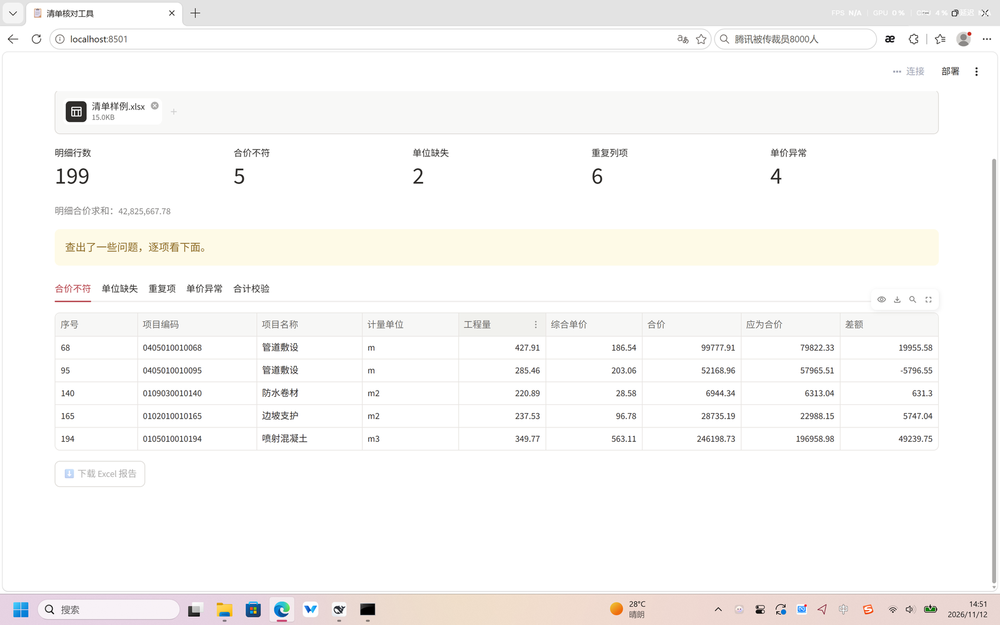

# 分部分项清单核对工具

> 把造价清单里那些“要人眼逐行看”的错，一条命令揪出来：合价算错、单位漏填、重复列项、单价异常。
> 命令行和网页界面两种用法，结果可直接导出成 Excel 报告。



---

## 它能查什么

| # | 检查项 | 判定规则 | 样例命中 |
|---|---|---|---|
| 1 | **合价不符** | 合价 ≠ 工程量 × 综合单价（容差 1 分钱） | 5 行 |
| 2 | **单位缺失** | 计量单位为空 | 2 行 |
| 3 | **重复列项** | 同「项目编码 + 项目名称 + 计量单位」出现多次，同组序号一并标出 | 6 行（3 对） |
| 4 | **单价异常** | 同「项目名称 + 计量单位」的单价，偏离组内中位数 50% 以上 | 4 行 |
| 5 | **合计校验** | 明细合价求和 vs 表内合计行，差额与方向 | — |

样例共 **199 行**（196 行基础数据 + 3 行重复抄本），脚本里**故意埋了 14 处错**，跑完能全部对上。

---

## 怎么跑

### 方式一：命令行走批处理

```bat
run.bat
```

跑完在 `out\核对报告.xlsx` 生成报告，控制台同时打印汇总。

### 方式二：网页界面

```bat
install-ui.bat    :: 第一次装依赖，只需一次
start-ui.bat      :: 启动后自动打开 http://localhost:8501
```

界面上传 Excel → 五个指标 + 五个明细标签页 → 一键下载报告。

> 界面依赖 **Streamlit**，检查逻辑与命令行版完全共用 `src/audit.py`，改一处两边都生效。

---

## 目录结构

```
01-清单核对/
├─ src/
│  ├─ audit.py          # 全部检查逻辑（读表、四项校验、出报告）
│  └─ app.py            # Streamlit 界面，只负责展示，不含业务逻辑
├─ data/
│  ├─ make_sample.py    # 造 199 行样例，埋 14 处错
│  └─ 清单样例.xlsx     # 生成的样例（不入版本库）
├─ out/
│  └─ 核对报告.xlsx     # 生成的报告（不入版本库）
├─ docs/
│  └─ ui.png            # 界面截图
├─ run.bat              # 命令行版
├─ install-ui.bat       # 装界面依赖
├─ start-ui.bat         # 启动界面
├─ api速查.md            # pandas / os / Git 速查，写代码时随手翻
├─ requirements.txt
└─ README.md
```

---

## 技术栈

- **Python 3.12** + **pandas**：读表、筛选、分组、异常检测
- **openpyxl**：写多工作表 Excel 报告
- **Streamlit**：网页界面
- **Git**：版本管理

---

## 几个实现上的取舍

- **合价用容差 0.01 而不是 `==`**：合价保留两位小数，`工程量 × 单价` 是全精度，直接比会把 194 行正确数据判成错。
- **「合计」行先拆出去**：它没有工程量和单价，混在明细里会让求和翻倍。
- **重复项用 `keep=False`**：一组里所有成员都标出来，并且多一列「重复组」，让人看出“跟谁撞了”。
- **单价异常阈值 50%**：30% 会对价格区间宽的项目误报（如防水卷材 28–48 元），50% 在样例上正好把 4 处真异常和 1 处正常波动分开。
- **空值要单独查**：`NaN` 参与比较永远为 `False`，用它筛异常行时会**静默漏掉**，所以单位缺失单独一项检查。

---

## 已知限制

- 只读第一个工作表
- 只支持 `.xlsx`，不读 `.xls`
- 单价异常假设同组价格分布集中，对极偏态分布（个别项目价差本身很大）仍可能误报
- 没有做列类型校验（比如合价列混进文字）

---

## 开发过程

10 天从零写到能用，每天一个可验证的小目标：

| 阶段 | 内容 |
|---|---|
| D1–D2 | 跑通、读懂 `load_statement` / `check_amount` / `check_total` |
| D3–D5 | 写 `check_duplicate`：判定键、`keep=False`、重复组列 |
| D6–D7 | 写 `check_price_outlier`：分组中位数、偏离比例、阈值调参 |
| D8 | 包一层 Streamlit 界面 |
| D9–D10 | README、截图、推 GitHub |

---

## 面试怎么讲（30 秒）

> “我在造价岗做过清单复核，几百行的表靠眼睛看很容易漏。我写了个脚本：读清单、校合价、查重复项和单价异常，直接出 Excel 报告，还包了个网页界面。样例 199 行，埋了 14 处错，全部揪出来。”
